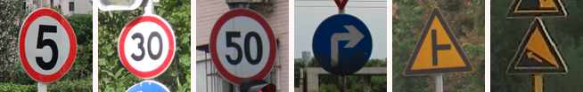

# Traffic Sign Recognition on an MCU — 17 classes in 9,984 bytes of RAM

An int8 convolutional classifier for traffic signs that runs on a microcontroller
with **no inference framework underneath it**. Images arrive over UART, predictions
go back over UART, and the whole network executes inside 9,984 bytes of statically
allocated SRAM with no heap.

Built for **AI Arena 2026, Track 1** (AI on Embedded Systems), where it placed
**1st** — team *Agent Smiths*: Sumit Raj and Shreyes Shalgar.

```
TSR 2026.08.28-t3f | 48x48x3 | 17 classes | arena 9984 B | val 99.73%
READY
> 8f8e91908f92...
RECEIVED 6912 bytes
PREDICTION class=69 label=height_limit confidence=99.87%
READY
```

---

## What it does

| | |
|---|---|
| **Task** | 17-class traffic sign classification, 48×48×3 RGB |
| **Validation accuracy** | **99.73 %** — 363 / 364, one error |
| **Peak inference RAM** | **9,984 B** — two static buffers + row scratch, no heap |
| **Model in flash** | 72,408 B int8 TFLite / 63,740 B of weights in firmware |
| **Parameters** | 62,145 |
| **Multiply-accumulates** | 6,885,440 int8 MAC per inference |
| **Runtime** | 337 lines of C, `<stdint.h>` and `<string.h>` only |
| **Targets** | `qemu_x86` and `esp32s3_devkitc/esp32s3/procpu`, Zephyr RTOS 4.4 |
| **Link** | UART 115200 8N1, hex-framed |

The ESP32-S3 image occupies 199,700 B of flash (1.2 % of a 16 MB part), 69,808 B
of DRAM and 37,828 B of IRAM. The 9,984 B arena is the only working memory the
inference itself needs.

## The three things worth reading the code for

**1. No framework.** `src/qemu_app/src/tsr_model.c` is the entire inference
engine — 337 lines of C that execute this specific graph. There is no
interpreter, no operator registry, no flatbuffer parsing, no `malloc`. The
weights are a `const` array in flash. The trade is deliberate and its cost is
stated in [`docs/TECHNICAL_WRITEUP.md`](docs/TECHNICAL_WRITEUP.md): the code no
longer runs *any* model, only this one.

**2. It is bit-exact against TensorFlow.** Not "close" — the same integers.
Against TFLite's **reference** int8 kernels (`OpResolverType.BUILTIN_REF`;
XNNPACK does not reproduce reference int8 arithmetic) the C runtime agrees on
**364 / 364 argmax** and **362 / 364 complete 17-value score vectors**, the two
exceptions differing by a single LSB on a handful of logits with the argmax
unchanged. Quantisation itself changed **0 of 364 predictions**: the float32 and
int8 graphs both score 363/364, and on the same images. `scripts/verify_all.py`
re-checks this on every change and fails if argmax agreement ever drops.

**3. The same image fails the same way everywhere.** Image 281 — a *steep
ascent* sign read as *steep descent*, its mirror — is the single error on native
x86, under QEMU, and on real Xtensa silicon, at the same 82.97 % confidence.
Determinism across three very different machines is the property that makes an
embedded number mean something.


*Classes 83 and 84 — steep descent and steep ascent. The only pair the model
confuses, and the only pair that is a reflection of the other.*

## Fusion: how the arena got to 9,984 bytes

A naive schedule materialises every intermediate tensor. Fusing the convolution
with the max-pool that follows it means the wide pre-pool tensor is never
written at all; fusing *two* convolutions and a pool into one sliding-window
pass removes the second one as well.

| schedule | arena |
|---|---:|
| unfused | 27,648 B |
| conv + pool fused | 15,360 B |
| conv + conv + pool fused | **9,984 B** |

Cost: 2,688 B of extra code. Accuracy change: **zero**, verified byte-identical
on all 364 × 17 logits against the pair-fused schedule. It is also 2.24× faster
natively and 1.64× faster under QEMU, because the bytes that are never written
are also never read back.

## Training: what actually moved the number

The interesting work was not the architecture.

**The dataset had a shortcut in it.** Seven of the 17 classes were supplied as
clean 32×32 pictogram crops while the other ten were photographs.


*Seven classes arrived like this — flat, centred, synthetic.*


*The other ten arrived like this. Telling the two apart is not the task.*

A model trained on that learns *image statistics*, not *signs* — and scores
beautifully on a validation set with the same split. Compositing those
pictograms onto photographic backgrounds with perspective, blur, JPEG and
lighting variation produced a stress set the in-distribution model failed badly:


*Original pictogram, then three synthesised photographic views of it.*

| | validation | stress (pictogram classes) |
|---|---|---|
| in-distribution model | 99.45 % | **59.15 %** |
| domain-hardened model | 98.90 % | **96.48 %** |
| shipped (domain + night) | **99.73 %** | 96.7 % |

**Grayscale robustness was nearly free and nearly essential.** Without grayscale
augmentation the model scored 98.35 % on RGB and **74.18 %** on the same images
in grayscale. With it: 99.45 % and 99.18 %. An automotive camera pipeline that
hands you luma is not a hypothetical.

**Low light was modelled physically, not faked.** Alpha-blending toward black
overstates robustness because it omits shot noise. A de-gamma → Poisson →
Gaussian-read-noise sensor model at matched brightness disagrees with it exactly
where noise starts to dominate. Training on the honest one lifted 0.85-darkness
accuracy from 91.76 % to 96.98 %.

## What was tried and rejected

Recorded because the negative results took as long as the positive ones:
ensemble distillation, temperature scaling (it would have *raised* the scored
confidence figure while destroying its meaning), a 1.5× wider model, TensorFlow
Lite Micro, Xtensa SIMD intrinsics, six-view test-time augmentation, and a
train+validation retrain that scored 84.07 % on the stress set — memorisation
wearing the validation set's clothes. Each is written up with its measurement in
[`docs/TECHNICAL_WRITEUP.md`](docs/TECHNICAL_WRITEUP.md).

## Quick start

```bash
# 1. the numerical claim, no board and no QEMU needed (~1 minute)
gcc -O2 -std=gnu99 -o host_test test/host_test.c \
    src/qemu_app/src/tsr_model.c src/qemu_app/src/tsr_model_data.c -lm
python -c "import numpy as np; open('va.raw','wb').write(np.load('out/data.npz')['Xva'].tobytes())"
./host_test va.raw > /dev/null      # prints: images=364  arena=9984 B

# 2. the full gate: five stages, including bit-exactness and app-source equality
python scripts/verify_all.py

# 3. one image end to end through QEMU
python scripts/send_image_qemu.py src/qemu_app/binaries/zephyr.elf samples/class69_height_limit.png

# 4. all 364 images over the real UART protocol under QEMU
python scripts/qemu_uart_eval.py --elf src/qemu_app/binaries/zephyr.elf --mode rgb48
```

Requires Python 3.10+, NumPy, Pillow, and either `tensorflow` or the much
smaller `ai-edge-litert` for the reference-kernel checks. Steps 1 and 2 need no
board, no QEMU and no RTOS.

**Zephyr is not vendored here** — this is a Zephyr *application*, and the RTOS
is fetched, not copied. `west.yml` pins it at tag **v4.4.0** and narrows
`west update` to the six modules these two boards need, so the workspace lands
around 1 GB instead of 7:

```bash
pip install west && west init -l . && west update && west zephyr-export
```

[`docs/BUILD.md`](docs/BUILD.md) has the whole flow, including the Zephyr SDK;
flashing an ESP32-S3 is [`docs/FLASHING.md`](docs/FLASHING.md).

## Layout

```
west.yml            pins Zephyr v4.4.0 + the six modules these boards need
src/                training and export pipeline (Python)
  qemu_app/         Zephyr application for qemu_x86      + prebuilt zephyr.elf
  esp32_app/        Zephyr application for ESP32-S3      + prebuilt zephyr.bin/.elf
                    (src/ byte-identical to qemu_app; only the build config differs)
scripts/            host tools: send an image, score a sweep, flash a board, run the gate
test/               native harness and micro-benchmark for the C runtime
model/              trained Keras model, float32 and int8 TFLite, quantisation report
out/data.npz        preprocessed dataset — see docs/DATA.md before publishing
samples/            one example image per class
docs/               technical write-up, results, flashing guide, protocol, dev notes
```

## Documentation

| | |
|---|---|
| [`docs/TECHNICAL_WRITEUP.md`](docs/TECHNICAL_WRITEUP.md) | the long form — every design decision and the measurement behind it |
| [`docs/BUILD.md`](docs/BUILD.md) | getting Zephyr, the SDK, and both builds |
| [`docs/RESULTS.md`](docs/RESULTS.md) | every headline number, and the command that reproduces it |
| [`docs/PROTOCOL.md`](docs/PROTOCOL.md) | the UART wire protocol |
| [`docs/FLASHING.md`](docs/FLASHING.md) | building and flashing the ESP32-S3, end to end |
| [`docs/DATA.md`](docs/DATA.md) | dataset provenance and how to remove it |
| [`docs/metrics.json`](docs/metrics.json) | the same numbers, machine-readable |
| [`docs/dev_notes/`](docs/dev_notes/) | the agent instructions used during development |

## Honest limits

- Accuracy is measured on **364 validation images**. That is a small set, and
  one error is one error — the confidence interval is wide. Treat 99.73 % as
  "no systematic failure found", not as a guarantee.
- The stress and low-light sets are **our own constructions**. They are evidence
  about robustness, not a held-out benchmark.
- The submitted target is the **ESP32-S3**; it was built and linked but the
  364-image hardware sweep was run on an **ESP32-D0WD-V3** bench proxy. Same
  source, same results, different silicon.
- Timing figures are wall-clock on specific machines and will not transfer.
- Nothing here is safety-qualified. It is a hackathon entry with its
  measurements written down.

## License

Code is MIT — see [LICENSE](LICENSE). The dataset in `out/data.npz` and
`samples/` was supplied by the challenge organisers and is **not** covered by
that license; see [`docs/DATA.md`](docs/DATA.md).
